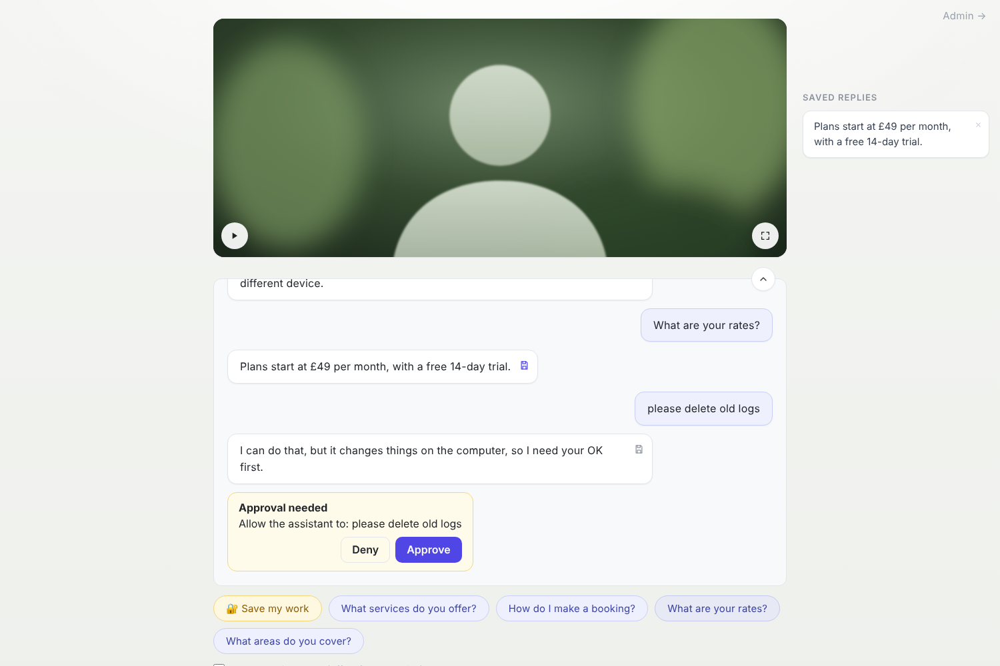
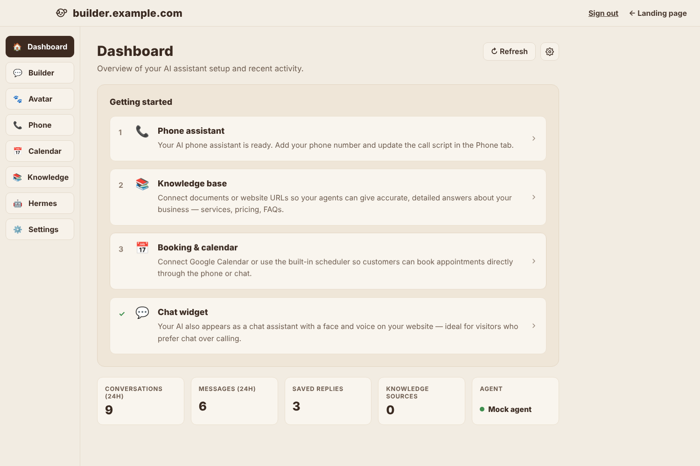

# agent-ui

Open-source **React + TypeScript** boilerplate for AI agent products: a visitor chat with a talking avatar, plus an
admin console. Built to sit in front of **[Hermes Agent](https://hermes-agent.nousresearch.com)** through
[agent-api](https://github.com/DashCoder/agent-api), and reusable across projects.

| Chat | Admin |
|---|---|
|  |  |

**Visitor chat (`/`)**
- Video avatar with play/voice and full-screen buttons; idle and talking clip loops, or a poster image
- Streaming replies with friendly progress ("Checking the calendar…") and approval cards for risky actions
- Save any reply to the **Saved replies** side panel; **🔐 Save my work** links saved work to an email
- Quick-reply chips, a **Learn and improve** toggle, file attachments, and replies read aloud (Web Speech API)

**Admin console (`/admin`)**
- Dashboard with a *Getting started* checklist and stats
- Builder (chat preview), Avatar, Phone, Calendar, Knowledge, **Audit trail**, **Hermes** (status, skills, setup steps, link to the full
  Hermes dashboard), and Settings (branding, greeting, quick replies, business answers)

## Try it locally (5 minutes, no Hermes needed)

You need Python 3.11+ and Node 18+ (`brew install python@3.12 node` on a Mac). Put both projects side by side,
e.g. `~/dev/agent-api` and `~/dev/agent-ui`.

**1. Start the backend** (Terminal tab 1). It runs a built-in mock agent:
```bash
cd ~/dev/agent-api
python3 -m venv .venv && source .venv/bin/activate
pip install -e ".[dev]"
cp .env.example .env          # HERMES_MODE=mock, admin password "admin"
uvicorn app.main:app --reload --port 8000
```
Check: http://localhost:8000/api/health shows `"mode":"mock"`.

**2. Start the UI** (Terminal tab 2):
```bash
cd ~/dev/agent-ui
npm install
cp .env.example .env
npm run dev
```

**3. Open http://localhost:5173 and try:**

| Try | What should happen |
|---|---|
| Click **What are your rates?** | The reply streams in: "Plans start at £49…" |
| Click the save icon on a reply | It appears under **Saved replies** |
| Type "delete old logs" | An **Approve / Deny** card appears |
| **🔐 Save my work** → any email | Dev mode shows the code on screen → enter it |
| Press ▶ on the avatar | Replies are read aloud |
| **Admin →**, log in as `admin` / `admin` | Dashboard, then Settings, Avatar and Hermes pages |
| Change the assistant name in **Settings** | The chat placeholder becomes "Ask <name> anything…" |

**Automated UI tests** (no backend needed): `npx playwright install chromium` (first time only), then
`npm run test:e2e` in agent-ui.

**Use the real agent:** set `HERMES_MODE=hermes` and `HERMES_API_KEY` in `agent-api/.env`, then restart the backend.
See [docs/HERMES_MAC_MINI_SETUP.md](docs/HERMES_MAC_MINI_SETUP.md), section 10.

## Scripts

| Command | What it does |
|---|---|
| `npm run dev` | Vite dev server |
| `npm run build` | Type-check + production build to `dist/` |
| `npm run typecheck` | TypeScript only |
| `npm run test:e2e` | Playwright tests (desktop + mobile), against a mocked API, no backend needed |

First Playwright run on a new machine: `npx playwright install chromium`.

## Plugins

Extra admin pages can ship as **UI plugins** that live outside this repo. A plugin file exports a list of
`AgentUIPlugin`; build the app with it by pointing `AGENT_UI_PLUGINS` at that file:

```bash
AGENT_UI_PLUGINS=../my-plugins/index.ts npm run build
```

```tsx
// ../my-plugins/index.ts(x)
import { PageHeader, request, UI_PLUGIN_API, type AgentUIPlugin } from '@agent-ui/core';

function Reports() { return <PageHeader title="Reports" />; }

const plugins: AgentUIPlugin[] = [
  { id: 'reports', apiVersions: [UI_PLUGIN_API],
    adminPages: [{ path: 'reports', label: 'Reports', icon: '📈', element: <Reports />, after: 'knowledge' }] },
];
export default plugins;
```

Plugins import only `@agent-ui/core` (API helpers, shared types, `PageHeader`, `FormFooter`) plus `react`,
`react-dom` and `react-router-dom`, which resolve to this repo's copies. A plugin that doesn't support this build's
`UI_PLUGIN_API` is skipped with a console warning. The default build has no plugins; `tests/fixtures/demo-plugin.tsx`
is a complete example and is loaded by the e2e tests.

## Customise

- **Look:** colours, fonts and radii are tokens in `src/styles/tokens.css` (chat and admin themes are separate).
- **Text and quick replies:** Admin → Settings (stored by agent-api), no code changes needed.
- **Avatar:** Admin → Avatar. Add looping clips (idle and talking) or a poster image. To use Simli, MuseTalk or another
  live avatar, replace `src/components/AvatarPanel.tsx`. Its `talking` prop tells you when the assistant is replying.
- **Voice:** `src/hooks/useSpeech.ts` uses the browser's speech; swap `speak()` for your own TTS.
- **Admin pages:** add a page in `src/pages/admin/`, a route in `src/App.tsx`, and an entry in `NAV` in
  `src/pages/admin/AdminLayout.tsx`.
- **API:** all calls are in `src/api/client.ts`; types in `src/api/types.ts`.

## Structure

```
src/
  api/            client (fetch + SSE parser) and types
  components/     ChatExperience, AvatarPanel, MessageBubble, Composer, SavedReplies, SaveWorkForm, ApprovalCard
  hooks/          useChat (sessions + streaming), useSiteConfig, useSpeech
  pages/          ChatPage, LoginPage, admin/*
  styles/         tokens.css, base.css, chat.css, admin.css
tests/e2e/        Playwright specs + an in-memory mock of agent-api
docs/             HERMES_MAC_MINI_SETUP.md: install Hermes on a Mac mini and connect this UI
```

## Deploy

Build (`npm run build`) and serve `dist/` from the same origin as agent-api. agent-api's `deploy/Caddyfile` does
this on a Mac mini. Full walkthrough: [docs/HERMES_MAC_MINI_SETUP.md](docs/HERMES_MAC_MINI_SETUP.md)
(or open `docs/HERMES_MAC_MINI_SETUP.html` in a browser).

## License

MIT
